# 📈 AlphaStreams - Ultimate Quantitative Analytics & Interview Mastery Guide

> [!IMPORTANT]
> **COMPREHENSIVE MASTER INTERVIEW RESOURCE**  
> This guide contains the complete, battle-tested architectural, mathematical, and implementation details of **AlphaStreams V2**. It bridges theoretical financial engineering (Black-Scholes-Merton, Crank-Nicolson PDE solvers) with production backend systems (FastAPI, Redis Streams/Pub/Sub, TimescaleDB, Hexagonal Architecture, Multi-Channel Notifications). Use this document to master every line of code, design trade-off, and edge-case response for technical interviews.

---

## 1. RESUME SNIPPETS & 30-SECOND DEFENSES

### LaTeX Code for Resume
```latex
\resumeProject
  {AlphaStreams --- Real-Time Quant Analytics & Option Pricing Engine}
  {Python, FastAPI, Redis Streams, TimescaleDB (PostgreSQL), Celery, Docker}
  {June 2026}
  {}
  \resumeItemListStart
    \item {Architected a modular monolith using Domain-Driven Design (DDD) and Hexagonal Architecture in FastAPI, isolating Ingestion, Analytics, Notifications, and Historical OHLC bounded contexts via strict Ports and Adapters interfaces.}
    \item {Engineered an asynchronous options pricing pipeline on durable Redis Streams consumer groups (ack, retry, dead-letter), pricing European options via closed-form Black-Scholes-Merton and a Crank-Nicolson PDE solver (dividend yield, adaptive grid, Rannacher smoothing) accurate to within Rs 0.19 of the closed form.}
    \item {Batched a whole option chain into one block-diagonal sparse system pre-factorized with SuperLU and split across a process pool, raising throughput from 66 to about 1,300 contracts/s on 4 workers.}
    \item {Built a real-time alert engine with verified Supabase JWT ownership, fire-on-crossing rules on spot price and ATM IV, atomic Postgres cooldowns, and delivery over WebSockets, HMAC-signed webhooks and email.}
    \item {Constructed a WebSocket gateway fed by Redis Pub/Sub, persisting time-series data in TimescaleDB hypertables with automated chunk retention (90-day ticks, 14-day alert logs, 90-day OHLC bars).}
    \item {Implemented multi-tenant persistent watchlists and profile state using Supabase PostgreSQL with Row Level Security (RLS) policies and Google OAuth authentication.}
  \resumeItemListEnd
```

### Microscopic Line-by-Line Resume Defense

| Bullet Concept | What It Means Technically | Exact Interview Response |
|---|---|---|
| **Modular Monolith & Bounded Context Split** | Decoupling domain logic into isolated packages (`domains/ingestion`, `domains/analytics`, `domains/notifications`, `domains/historical`) communicating strictly via abstract input/output interfaces (Ports) and durable event streams (`stream:options.raw_fetched`, `stream:options.priced`). | *"I organized the project as a Modular Monolith following Hexagonal Architecture across distinct bounded contexts: Ingestion, Analytics, Notifications, and Historical data. Business math logic never touches HTTP requests or database code directly. Instead, domain interfaces (`IOptionChainSourcePort`, `IAlertRuleRepositoryPort`) let us swap external market providers or persistence engines without altering core pricing formulas."* |
| **Async Pipeline (Redis Streams & Celery)** | Decoupling data retrieval from computationally heavy pricing algorithms using a durable, append-only log (`stream:options.raw_fetched`). | *"Celery Beat polls raw option chains asynchronously from external market adapters and publishes them to a Redis Stream. A background consumer daemon (`OptionsPricingSubscriber`) picks up raw tick frames, executes options pricing math off the HTTP event loop, and pushes processed events down the stream."* |
| **Crank-Nicolson PDE & SuperLU Factorization** | A second-order finite difference scheme solving the Black-Scholes PDE (with dividend yield q) over an $M \times N$ grid using pre-factorized sparse matrices (`scipy.sparse.linalg.splu`). | *"I solve the Black-Scholes PDE with Crank-Nicolson as a cross-check on the closed form and as the general method for exotic payoffs. The grid spans four standard deviations around spot and strike, the first steps are fully implicit (Rannacher) to smooth the payoff kink, and the tridiagonal matrix A is factorised once with SuperLU, so each step is O(M). It matches closed-form BSM to within 19 paise across strikes ±10%, 1–60 days and 10–40% IV."* |
| **Batched chain pricing** | Stacking every contract's tridiagonal matrix into one block-diagonal system and splitting the chain across a spawn-based process pool. | *"Pricing 100 contracts one by one was dominated by Python loop overhead. I stack a chunk of contracts into one block-diagonal matrix, so each time step is one sparse product and one SuperLU solve for all of them, and give each worker one chunk. End to end that went from 66 contracts/s to 527 on one worker and 1,291 on four."* |
| **Real-Time Notification Engine & Multi-Channel Dispatch** | A consumer-group daemon (`NotificationStreamSubscriber`) evaluating each user's symbol-level rules (spot price above/below, ATM IV %) once per priced chain, firing only on a false→true crossing, with an atomic cooldown. | *"The notifications domain reads `stream:options.priced` through a consumer group. For each rule, one conditional `UPDATE … RETURNING` in Postgres records the new condition state and enforces the cooldown in a single statement, so two workers can never both fire. Alerts go only through the channels on the rule: WebSocket toasts to the owner's authenticated sockets, HMAC-signed webhooks with retries, or SMTP email off the event loop."* |
| **TimescaleDB Hypertables & Multi-Tier Retention** | Time-partitioned PostgreSQL tables optimized for high-frequency write ingestion and time-range queries, paired with automated table chunk purging across multiple domains. | *"Time-series data is persisted in TimescaleDB hypertables partitioned into 1-day chunks, with retention policies of 90 days for raw ticks (`TickData`), 14 days for alert audit records (`NotificationLogs`) and 90 days for candles (`OhlcCandles`). Dropping a chunk deletes a file instead of running a row-by-row `DELETE`. Unchanged chains (outside market hours) are not re-inserted at all."* |
| **WebSockets + Redis Pub/Sub Gateway** | Live push to browsers: Pub/Sub carries small `{symbol, last_updated}` notifications and the browser refetches the priced chain. | *"Each API worker runs one pattern subscription and fans messages out to per-client bounded queues; slow or idle clients are closed with 4000-series codes and reconnect with backoff. Alerts carry a user id and go only to sockets that authenticated as that user. Slider recalculation runs in the browser with a Hastings normal-CDF approximation, so it needs no server call."* |

### Measured Numbers (November 2026)

All measured on an Intel i5-12450H, Python 3.11, NumPy 1.26.4, SciPy 1.17.1. Quote these, not round guesses.

| Metric | Value | How it was measured |
|---|---|---|
| CN accuracy vs closed-form BSM | worst ₹0.19, mean ₹0.022 (was ₹21.20 / ₹0.94) | strikes ±10%, 1–60 days, 10–40% IV, calls and puts (`tests/unit/test_pde_solver.py`) |
| Worked example (NIFTY 24200C, 30 d, 14% IV, q 1.2%) | CN 339.15 vs BSM 339.14 (was 349.12) | `docs/SuperLU_PDE_Explanation.md` |
| SuperLU pre-factorisation, one contract | 23.3 ms → 5.8 ms (−75%, 4.0×) at M = N = 300 | `spsolve` every step vs `splu` once, identical prices |
| Batched chain, one core | 605 ms → 202 ms for 100 contracts (3.0×) | per-contract loop vs `price_chain_cn` |
| End-to-end pricing throughput | 527 / 975 / 1,291 contracts/s on 1 / 2 / 4 workers | `OptionsPricingSubscriber.process_event`, 100-contract chain, CN + BSM per contract |
| Before batching | 66 (sequential), 28 (threads), ~560 (4 processes) contracts/s | same benchmark |
| LAPACK `gttrs` vs SuperLU on the batched system | 1.3× | kept SuperLU |
| Unit tests | 196 passing in ~15 s | `python -m pytest` |
| Outage response time | 286 s → 25 s to a clean 503 | overall live-fetch deadline |

---

## 2. HIGH-LEVEL (HLD) & LOW-LEVEL DESIGN (LLD) ARCHITECTURE

### System Architecture Flow Diagram (HLD)

```
┌──────────────────────────────────────────────────────────────────────────────────────────────────┐
│                                       EXTERNAL DATA LAYER                                        │
│  ┌───────────────────────────┐   ┌───────────────────────────┐   ┌────────────────────────────┐  │
│  │    Groww API (Primary)    │   │  NSE India (HTTP Scraper) │   │   yfinance (OHLC Quote)    │  │
│  └─────────────┬─────────────┘   └─────────────┬─────────────┘   └─────────────┬──────────────┘  │
└────────────────┼───────────────────────────────┼───────────────────────────────┼─────────────────┘
                 │                               │                               │
                 └───────────────────────┬───────┴───────────────────────────────┘
                                         │ (HTTP / 10-Min Session Cookie Warmup)
┌────────────────────────────────────────┼─────────────────────────────────────────────────────────┐
│ 1. INGESTION BOUNDED CONTEXT (`domains/ingestion`)                                               │
│  ┌────────────────────────────────────────────────────────────────────────────────────────────┐  │
│  │                              AdapterFactory                                                │  │
│  │             ┌──────────────────────────────┴──────────────────────────────┐                │  │
│  │             ▼                                                             ▼                │  │
│  │    [ GrowwApiAdapter ]                                           [ NseApiAdapter ]         │  │
│  │   (Dynamic OAuth Header)                                  (Active 10-min Cookie Rotation)  │  │
│  └────────────────────────────────────────────┬───────────────────────────────────────────────┘  │
│                                               │                                                  │
│                                               ▼                                                  │
│                               [ IngestionService Orchestrator ]                                  │
│                                 (Celery Scheduled Ingestion)                                     │
└───────────────────────────────────────────────┬──────────────────────────────────────────────────┘
                                                │
                                                │ (Publish Raw Option Ticks)
                                                ▼
┌──────────────────────────────────────────────────────────────────────────────────────────────────┐
│ MESSAGING & STREAMING LAYER (REDIS)                                                              │
│  ┌────────────────────────────────────────────────────────────────────────────────────────────┐  │
│  │  Redis Stream: `stream:options.raw_fetched` (Durable Append-Only Log)                      │  │
│  └────────────────────────────────────────────┬───────────────────────────────────────────────┘  │
└───────────────────────────────────────────────┼──────────────────────────────────────────────────┘
                                                │
                                                │ (Consume Raw Ticks)
                                                ▼
┌──────────────────────────────────────────────────────────────────────────────────────────────────┐
│ 2. ANALYTICS BOUNDED CONTEXT (`domains/analytics` - Quantitative Math Engine)                    │
│  ┌────────────────────────────────────────────────────────────────────────────────────────────┐  │
│  │                           OptionsPricingSubscriber Daemon                                  │  │
│  │      (Consumer group; batched CN solves in a spawn ProcessPoolExecutor, PRICING_WORKERS)   │  │
│  │                                                                                            │  │
│  │   ┌─────────────────────────────────────────┐    ┌──────────────────────────────────────┐  │  │
│  │   │  Black-Scholes Analytical Engine (BSM)  │    │  Crank-Nicolson PDE Numerical Solver │  │  │
│  │   │   - Exact Fair Call / Put Price         │    │   - Spatial & Temporal Grid ($M, N$) │  │  │
│  │   │   - 5 Dynamic Greeks ($\Delta, \Gamma, \nu, \Theta, \rho$)│    │   - SuperLU Sparse Matrix LU Factor  │  │  │
│  │   │   - Continuous Dividend Yield ($q$)     │    │   - ±4σ grid, q, Rannacher start-up  │  │  │
│  │   └─────────────────────────────────────────┘    └──────────────────────────────────────┘  │  │
│  │                                                                                            │  │
│  │   ┌────────────────────────────────────────────────────────────────────────────────────┐   │  │
│  │   │  Technical Indicators Engine (Vectorized RSI, MACD, EMA, Bollinger Bands, Pivots)  │   │  │
│  │   └────────────────────────────────────────────────────────────────────────────────────┘   │  │
│  └────────────────────────────────────────────┬───────────────────────────────────────────────┘  │
└───────────────────────────────────────────────┼──────────────────────────────────────────────────┘
                                                │
                     ┌──────────────────────────┴──────────────────────────┐
                     │ (Publish Priced Stream)                             │ (Broadcast Option Updates)
                     ▼                                                     ▼
┌──────────────────────────────────────────────────┐  ┌────────────────────────────────────────────┐
│ 3. NOTIFICATIONS CONTEXT (`domains/notifications`) │  │ REDIS PUB/SUB & CACHE INFRASTRUCTURE       │
│  ┌────────────────────────────────────────────┐  │  │  ┌──────────────────────────────────────┐  │
│  │      NotificationStreamSubscriber          │  │  │  │ Redis Key: `market:options:priced`   │  │
│  │   (Listens to `stream:options.priced`)     │  │  │  └──────────────────────────────────────┘  │
│  └─────────────────────┬──────────────────────┘  │  │  ┌──────────────────────────────────────┐  │
│                        ▼                         │  │  │ Pub/Sub: `market.options_updated`    │  │
│  ┌────────────────────────────────────────────┐  │  │  │ Pub/Sub: `market.price_updated`      │  │
│  │         EvaluateAlertsService              │  │  │  │ Pub/Sub: `alerts.dispatched`        │  │
│  │  - RuleMatcher (SPOT PRICE, ATM IV %)      │  │  │  └──────────────────┬───────────────────┘  │
│  │  - Crossing + cooldown (atomic UPDATE)     │  │  └─────────────────────┼──────────────────────┘
│  └─────────────────────┬──────────────────────┘                           │
│                        ▼                                                  │
│  ┌────────────────────────────────────────────┐                           │
│  │          Multi-Channel Dispatch            │                           │
│  │  - WebSocket Toast (`alerts.dispatched`)   │                           │
│  │  - Webhook POST (HMAC Signed + Retry)      │                           │
│  │  - Email (SMTP via asyncio.to_thread)      │                           │
│  └─────────────────────┬──────────────────────┘                           │
└────────────────────────┼──────────────────────────────────────────────────┼──────────────────────┘
                         │                                                  │
                         │ (Audit Execution)                                │
                         ▼                                                  ▼
┌──────────────────────────────────────────────────┐  ┌────────────────────────────────────────────┐
│ 4. HISTORICAL & PERSISTENCE (`domains/historical`)│  │ 5. APPLICATION & SERVING (`app/`, `frontend`)│
│  ┌────────────────────────────────────────────┐  │  │  ┌──────────────────────────────────────┐  │
│  │ TimescaleDB Hypertables (PostgreSQL)       │  │  │  │ FastAPI Uvicorn REST Routers         │  │
│  │  - `TickData` (90-Day Auto Retention)      │  │  │  │  - `/v1/pricer/ticker/{symbol}`      │  │
│  │  - `NotificationLogs` (14-Day Retention)   │  │  │  │  - `/v1/derivatives`, `/v1/technicals`│  │
│  │  - `OhlcCandles` (90-Day Retention)       │  │  │  │  - `/v1/alerts` (Alert Rule CRUD)    │  │
│  │  - `AlertRules` (Relational Table)         │  │  │  └──────────────────┬───────────────────┘  │
│  └────────────────────────────────────────────┘  │  │  ┌──────────────────┴───────────────────┐  │
└──────────────────────────────────────────────────┘  │  │ WebSocket Gateway (`/v1/ws/{symbol}`) │  │
                                                      │  └──────────────────┬───────────────────┘  │
                                                      └─────────────────────┼──────────────────────┘
                                                                            │ (WebSocket Frame Streaming)
                                                                            ▼
                                                      ┌────────────────────────────────────────────┐
                                                      │ CLIENT BROWSER / TRADING TERMINAL          │
                                                      │  - Glassmorphic UI Dashboard               │
                                                      │  - Hastings Normal CDF BSM Simulator (JS)  │
                                                      │  - Supabase Google OAuth & RLS Watchlists  │
                                                      └────────────────────────────────────────────┘
```

---

### Low-Level Design (LLD) Hexagonal Class Architecture

```mermaid
classDiagram
    %% Ingestion Bounded Context
    class IOptionChainSourcePort {
        <<interface>>
        +fetch_option_chain(symbol: str) OptionChainDTO
    }
    class IMarketPriceSourcePort {
        <<interface>>
        +fetch_spot_price(symbol: str) SpotPriceDTO
    }
    class IEventPublisherPort {
        <<interface>>
        +publish(stream_name: str, payload: dict) str
    }
    class GrowwApiAdapter {
        -str api_key
        -str cache_ttl
        +fetch_option_chain(symbol: str) OptionChainDTO
        +fetch_spot_price(symbol: str) SpotPriceDTO
    }
    class NseApiAdapter {
        -ClientSession session
        -datetime last_cookie_refresh
        +refresh_cookies()
        +fetch_option_chain(symbol: str) OptionChainDTO
        +fetch_spot_price(symbol: str) SpotPriceDTO
    }
    class IngestionService {
        -IOptionChainSourcePort option_fetcher
        -IMarketPriceSourcePort price_fetcher
        -IEventPublisherPort event_bus
        +ingest_options(symbol: str) bool
        +ingest_spot_price(symbol: str) bool
    }

    %% Analytics Bounded Context
    class BsmCalculatorDomainService {
        +calculate_greeks(S: float, K: float, T: float, r: float, sigma: float, q: float) GreeksDTO
        +solve_call(S: float, K: float, T: float, r: float, sigma: float, q: float) float
        +solve_put(S: float, K: float, T: float, r: float, sigma: float, q: float) float
    }
    class CrankNicolsonPDE {
        +float S0
        +float K
        +float T
        +float r
        +float sigma
        +int M
        +int N
        -float S_max
        -float dS
        -float dt
        +solve() float
    }
    class TechnicalIndicatorsEngine {
        +compute_rsi(prices: List[float], period: int) float
        +compute_macd(prices: List[float]) MACDDTO
        +compute_bollinger_bands(prices: List[float]) BBDTO
        +compute_pivots(high: float, low: float, close: float) PivotDTO
    }
    class OptionsPricingSubscriber {
        -Redis redis_client
        -BsmCalculatorDomainService bsm_engine
        +start_consuming()
        +process_raw_tick(payload: dict)
    }

    %% Notifications Bounded Context
    class IAlertRuleRepositoryPort {
        <<interface>>
        +save_rule(rule: AlertRule) AlertRule
        +get_active_rules_by_symbol(symbol: str) List[AlertRule]
        +update_last_triggered(rule_id: UUID, timestamp: datetime)
        +log_notification_event(event: NotificationEvent)
    }
    class INotificationChannelAdapterPort {
        <<interface>>
        +dispatch(event: NotificationEvent, rule: AlertRule) bool
    }
    class AlertRule {
        +UUID id
        +str symbol
        +ConditionType condition_type
        +float threshold
        +List[DeliveryChannel] channels
        +int cooldown_seconds
        +datetime last_triggered_at
        +bool is_active
        +UUID user_id
        +bool last_condition_met
        +str webhook_secret
    }
    class RuleMatcherDomainService {
        +match(rule: AlertRule, tick_payload: dict) Tuple[bool, float, str]
    }
    class EvaluateAlertsService {
        -IAlertRuleRepositoryPort repo
        -List[INotificationChannelAdapterPort] channels
        +evaluate_tick_event(symbol: str, tick_payload: dict) List[NotificationEvent]
    }
    class NotificationStreamSubscriber {
        -Redis redis
        -EvaluateAlertsService evaluator
        +start_consuming()
        +process_event(payload: dict)
    }
    class WebSocketNotificationChannelAdapter {
        +dispatch(event: NotificationEvent, rule: AlertRule) bool
    }
    class WebhookNotificationChannelAdapter {
        +dispatch(event: NotificationEvent, rule: AlertRule) bool
    }
    class EmailNotificationChannelAdapter {
        +dispatch(event: NotificationEvent, rule: AlertRule) bool
    }

    %% Historical OHLC Bounded Context
    class IOhlcRepositoryPort {
        <<interface>>
        +save_candle(candle: OhlcCandle)
        +get_candles(symbol: str, timeframe: str, limit: int) List[OhlcCandle]
    }
    class TimescaleOhlcRepository {
        -Pool db_pool
        +save_candle(candle: OhlcCandle)
        +get_candles(symbol: str, timeframe: str, limit: int) List[OhlcCandle]
    }

    %% Relationships
    IOptionChainSourcePort <|.. GrowwApiAdapter
    IOptionChainSourcePort <|.. NseApiAdapter
    IMarketPriceSourcePort <|.. GrowwApiAdapter
    IMarketPriceSourcePort <|.. NseApiAdapter
    IngestionService --> IOptionChainSourcePort
    IngestionService --> IMarketPriceSourcePort
    IngestionService --> IEventPublisherPort

    OptionsPricingSubscriber --> BsmCalculatorDomainService
    OptionsPricingSubscriber --> CrankNicolsonPDE
    OptionsPricingSubscriber --> TechnicalIndicatorsEngine

    INotificationChannelAdapterPort <|.. WebSocketNotificationChannelAdapter
    INotificationChannelAdapterPort <|.. WebhookNotificationChannelAdapter
    INotificationChannelAdapterPort <|.. EmailNotificationChannelAdapter
    EvaluateAlertsService --> IAlertRuleRepositoryPort
    EvaluateAlertsService --> INotificationChannelAdapterPort
    EvaluateAlertsService --> RuleMatcherDomainService
    NotificationStreamSubscriber --> EvaluateAlertsService

    IOhlcRepositoryPort <|.. TimescaleOhlcRepository
```



---

### Sequence Diagram: Multi-Domain Event-Driven Execution

```mermaid
sequenceDiagram
    autonumber
    participant Celery as Celery Scheduler
    participant Ingestion as Ingestion Service
    participant Adapter as NseApiAdapter / GrowwAdapter
    participant RawStream as Redis Stream (options.raw_fetched)
    participant PricingSub as OptionsPricingSubscriber
    participant MathEng as Analytics BSM / PDE / Greeks
    participant PricedStream as Redis Stream (options.priced)
    participant NotifSub as NotificationStreamSubscriber
    participant RuleMatcher as RuleMatcherDomainService
    participant ChannelAdapter as Channels (WS/Webhook/Email)
    participant PubSub as Redis Pub/Sub
    participant WSGateway as FastAPI WS Hub (/v1/ws/{symbol})
    participant Browser as Trading Web Terminal

    %% 1. Ingestion Phase
    Note over Celery, RawStream: 1. Ingestion Bounded Context
    Celery->>Ingestion: fetch_and_publish_options(symbol) (one poll leader per symbol, every 15 s)
    Ingestion->>Adapter: fetch_option_chain(symbol)
    Adapter-->>Ingestion: Return RawTickDTO list
    alt Chain hash unchanged
        Ingestion->>Ingestion: Skip TickData COPY and re-pricing
    else Chain changed
        Ingestion->>RawStream: XADD MAXLEN~10000 stream:options.raw_fetched (nearest expiry)
    end

    %% 2. Analytics Phase
    Note over RawStream, PricedStream: 2. Analytics Bounded Context
    RawStream->>PricingSub: XREADGROUP cg:options_pricing
    PricingSub->>MathEng: One batched CN chunk per worker (spawn process pool)
    MathEng->>MathEng: price_chain_cn (block-diagonal SuperLU) + vectorised BSM
    MathEng-->>PricingSub: Fair prices per contract
    PricingSub->>PricedStream: XADD stream:options.priced (chain, spot, ATM IV %)
    PricingSub->>PubSub: PUBLISH market.options_updated.{symbol} {symbol, last_updated}
    PricingSub->>RawStream: XACK (after success; retry then DLQ on failure)
    PubSub->>WSGateway: Pattern subscription relays notification
    WSGateway->>Browser: {"type": "options"}; browser refetches the chain

    %% 3. Notifications Phase
    Note over PricedStream, Browser: 3. Notifications Bounded Context
    PricedStream->>NotifSub: XREADGROUP cg:alert_evaluation
    NotifSub->>RuleMatcher: Match each active rule (spot price / ATM IV %)
    RuleMatcher-->>NotifSub: met = true/false
    NotifSub->>NotifSub: try_transition: UPDATE ... WHERE crossed AND cooldown elapsed RETURNING id
    alt Row returned (crossed false→true, outside cooldown)
        NotifSub->>ChannelAdapter: Dispatch via the rule's channels only
        par WebSocket
            ChannelAdapter->>PubSub: PUBLISH alerts.dispatched.{symbol} (with user_id)
            PubSub->>WSGateway: Forward alert
            WSGateway->>Browser: Toast on the owner's authenticated sockets only
        and Webhook
            ChannelAdapter->>ChannelAdapter: HTTPS POST, HMAC-signed with the rule's secret, retried with backoff
        and Email
            ChannelAdapter->>ChannelAdapter: SMTP in asyncio.to_thread
        end
        NotifSub->>NotifSub: Log to NotificationLogs hypertable
    else No row
        NotifSub->>NotifSub: Still true, re-armed, or in cooldown: nothing sent
    end
```

---

## 3. DEEP ARCHITECTURE DECISIONS & GENUINE TRADE-OFFS

### 1. Modular Monolith vs. Microservices
* **Decision:** Built the platform as a single deployable process structured into isolated domain packages (`domains/ingestion`, `domains/analytics`, `domains/notifications`, `domains/historical`, `shared`).
* **Why:** Microservices introduce distributed transaction overhead, network serialization latency between calls, complex multi-repo deployment pipelines, and service mesh management. For a quantitative analytics platform processing high-frequency option chains on single or dual nodes, in-memory function calls and local event queues deliver sub-millisecond execution without inter-service network serialization penalties.
* **Trade-off:** If ingestion or math computing spikes CPU to 100%, it could starve the FastAPI HTTP server if not properly offloaded to separate worker threads/processes.
* **Mitigation:** Pricing runs in its own subscriber process with a spawn-based `ProcessPoolExecutor` (threads would not help: the solver loop holds the GIL), ingestion runs in Celery workers, and the production compose file runs each process as a separate service.

### 2. Hexagonal Architecture (Ports & Adapters)
* **Decision:** Enforced clean separation where application core logic depends only on interfaces (Ports), while external APIs, databases, and message brokers implement those interfaces (Adapters).
* **Why:** Third-party financial data providers (like NSE India or Groww) frequently change endpoint structures, introduce rate limits, or suffer outages. By programming to `IOptionChainSourcePort`, we can swap data providers or mock them during unit tests without changing a single line of option pricing code.
* **Trade-off:** Adds abstraction overhead, requiring DTO transformations between external API responses and domain entities.
* **Mitigation:** Lightweight Pydantic models for fast validation and explicit DTO conversion.

### 3. Domain Decomposition: Splitting Ingestion, Analytics, Notifications, and Historical OHLC
* **Decision:** Explicitly separated the data pipeline into four independent bounded contexts:
  1. `domains/ingestion`: Pure HTTP/session management and raw data normalization.
  2. `domains/analytics`: Pure mathematical and financial engineering logic (BSM, PDE, Greeks, Technical Indicators).
  3. `domains/notifications`: User alert rules, real-time trigger evaluation, cooldown enforcement, and multi-channel delivery.
  4. `domains/historical`: Immutable OHLC candle persistence and 1m/5m/1d timeframe aggregation.
* **Why:** Coupling alert evaluation or historical aggregation inside the ingestion or pricing loop adds latency and violates the Single Responsibility Principle. If an external SMTP server hangs or an alert webhook fails, the options pricing loop and ingestion scheduler must continue unaffected.
* **Trade-off:** Requires asynchronous event streaming (`stream:options.raw_fetched` $\rightarrow$ `stream:options.priced`) to bridge domain boundaries.
* **Mitigation:** Redis Streams consumer groups with explicit acknowledgment (`XACK`), retries, dead-letter streams and reclaim of stalled messages (`XAUTOCLAIM`).

### 4. Redis Streams + Pub/Sub vs. Apache Kafka / RabbitMQ
* **Decision:** Utilized Redis Streams for durable tick logging (`stream:options.raw_fetched`, `stream:options.priced`) and Redis Pub/Sub (`market.options_updated.{symbol}`, `alerts.dispatched.{symbol}`) for real-time WebSocket broadcasting.
* **Why:** Kafka requires ZooKeeper/KRaft clusters, high RAM overhead, and substantial DevOps maintenance. RabbitMQ is optimized for AMQP routing but lacks lightweight in-memory caching. Redis already serves as our high-speed RAM cache; leveraging its Streams and Pub/Sub primitives eliminated extra infrastructure dependencies.
* **Trade-off:** Redis Streams store data in RAM. Unbounded stream growth can cause Memory OOM crashes.
* **Mitigation:** Applied approximate length trimming (`maxlen=10000, approximate=True`) on stream additions (`XADD`) and configured TimescaleDB for persistent historical tick storage.

### 5. TimescaleDB Multi-Hypertables vs. InfluxDB / MongoDB
* **Decision:** Selected PostgreSQL with the TimescaleDB extension for time-series persistence across three separate hypertables:
  - `TickData`: High-frequency raw tick prices (90-day automated chunk retention).
  - `NotificationLogs`: Triggered alert audit history (14-day automated retention).
  - `OhlcCandles`: 1m/5m/1d aggregated bars (90-day automated retention).
* **Why:** Pure NoSQL databases (MongoDB) lack strict ACID guarantees and financial SQL analytical aggregations (`time_bucket()`, moving averages). Dedicated TSDBs (InfluxDB) introduce a second query language (Flux/InfluxQL) and don't integrate with relational user auth tables. TimescaleDB provides standard SQL, hypertable automatic partitioning, and native retention policies while preserving relational integrity for user accounts, alert rules, and watchlists.
* **Trade-off:** PostgreSQL writes can bottleneck if unindexed or unpartitioned under high concurrency.
* **Mitigation:** Hypertables partitioned into 1-day chunks (`chunk_time_interval => INTERVAL '1 day'`) with automated chunk drop policies.

### 6. Tiered Fallback Chain & Fail-Fast HTTP 503 vs. Synthetic Mocking
* **Decision:** Implemented a fallback chain (Redis Cache $\rightarrow$ Groww API $\rightarrow$ Secondary NSE Scraper). If all external data sources fail, the API returns a strict `HTTP 503 Service Unavailable`.
* **Why:** Mocking or synthesizing synthetic option chains during upstream outage corrupts financial calculations, generating misleading Greeks and false arbitrage signals. In financial software, delivering no data is far safer than delivering inaccurate theoretical values.
* **Trade-off:** Temporary loss of API availability during upstream data vendor outages.

---

## 4. MATHEMATICAL SOLVER MODULE (IN-DEPTH SPECS & DERIVATIONS)

### 1. Analytical Black-Scholes-Merton (BSM) Model & Options Greeks

#### Closed-Form Formulation with Continuous Dividend Yield ($q$)
The BSM continuous dividend model evaluates theoretical European options:

$$d_1 = \frac{\ln\left(\frac{S_0}{K}\right) + \left(r - q + \frac{\sigma^2}{2}\right)T}{\sigma\sqrt{T}}$$
$$d_2 = d_1 - \sigma\sqrt{T}$$

* **Call Fair Price ($C_{BSM}$):**
  $$C_{BSM} = S_0 e^{-q T} N(d_1) - K e^{-r T} N(d_2)$$
* **Put Fair Price ($P_{BSM}$):**
  $$P_{BSM} = K e^{-r T} N(-d_2) - S_0 e^{-q T} N(-d_1)$$

Where:
- $S_0$: Current spot price of underlying asset
- $K$: Strike price
- $T$: Time to expiration in years ($\max(T, 10^{-6})$ safety guard against division by zero)
- $r$: Risk-free interest rate (e.g. 0.065 for 6.5%)
- $q$: Continuous dividend yield
- $\sigma$: Implied volatility ($\max(\sigma, 10^{-6})$ safety guard)
- $N(x)$: Cumulative distribution function of standard normal distribution

#### The 5 Primary Options Greeks Formulas

1. **Delta ($\Delta$):** First derivative of option price with respect to spot price.
   $$\Delta_{Call} = e^{-q T} N(d_1), \quad \Delta_{Put} = -e^{-q T} N(-d_1)$$
2. **Gamma ($\Gamma$):** Second derivative of option price with respect to spot price (rate of change of Delta).
   $$\Gamma = \frac{e^{-q T} n(d_1)}{S_0 \sigma \sqrt{T}} \quad \text{where } n(x) = \frac{1}{\sqrt{2\pi}} e^{-\frac{x^2}{2}}$$
3. **Vega ($\nu$):** Sensitivity of option price to a 1% change in implied volatility.
   $$\nu = \frac{S_0 e^{-q T} \sqrt{T} n(d_1)}{100}$$
4. **Theta ($\Theta$):** Daily rate of time decay.
   $$\Theta_{Call} = \frac{-\frac{S_0 e^{-q T} n(d_1) \sigma}{2 \sqrt{T}} + q S_0 e^{-q T} N(d_1) - r K e^{-r T} N(d_2)}{365}$$
   $$\Theta_{Put} = \frac{-\frac{S_0 e^{-q T} n(d_1) \sigma}{2 \sqrt{T}} - q S_0 e^{-q T} N(-d_1) + r K e^{-r T} N(-d_2)}{365}$$
5. **Rho ($\rho$):** Sensitivity of option price to a 1% change in interest rate.
   $$\rho_{Call} = \frac{K T e^{-r T} N(d_2)}{100}, \quad \rho_{Put} = \frac{-K T e^{-r T} N(-d_2)}{100}$$

---

### 2. Numerical Crank-Nicolson Partial Differential Equation (PDE) Solver

#### The Black-Scholes PDE
The pricing equation for any derivative option $V(S, t)$ is governed by:

$$\frac{\partial V}{\partial t} + \frac{1}{2}\sigma^2 S^2 \frac{\partial^2 V}{\partial S^2} + (r - q) S \frac{\partial V}{\partial S} - r V = 0$$

#### Grid Discretization
- **Price Domain:** $S \in [\min(S_0, K)\,e^{-w},\ \max(S_0, K)\,e^{w}]$ with $w = 4\sigma\sqrt{T}$: four standard deviations of the log-price at expiry beyond both spot and strike, in $M = 300$ uniform steps. For the worked example (NIFTY 24200 call, 30 days, 14% IV) that is 20,440 to 28,414, a node every 26.6 points (the old $[0, \max(3K, 2.5S_0)]$ grid had one every 242).
- **Time Domain:** $\tau \in [0, T]$ in $N = 300$ steps, $dt = T/N$.
- **Stability:** Crank-Nicolson is unconditionally stable for this equation, so there is **no CFL check**. The first 2 steps are replaced by 4 fully implicit half-steps (Rannacher start-up) to damp oscillations from the payoff's kink at the strike.

#### Tridiagonal Linear System Construction
Crank-Nicolson averages implicit and explicit finite difference schemes:

$$\mathbf{A} \mathbf{V}^{new} = \mathbf{B} \mathbf{V}^{old} + \text{boundary}$$

For inner nodes, with $D_i = \frac{\sigma^2 S_i^2}{2\,dS^2}$ and $R_i = \frac{(r - q) S_i}{2\,dS}$:
$$\alpha_i = \frac{dt}{2}(D_i - R_i), \qquad \beta_i = \frac{dt}{2}(2D_i + r), \qquad \gamma_i = \frac{dt}{2}(D_i + R_i)$$

- **Matrix $\mathbf{A}$ (Implicit side - LHS):** lower diagonal $-\alpha$, main diagonal $1 + \beta$, upper diagonal $-\gamma$.
- **Matrix $\mathbf{B}$ (Explicit side - RHS):** lower diagonal $\alpha$, main diagonal $1 - \beta$, upper diagonal $\gamma$.

#### SuperLU Sparse Matrix Optimization & Boundary Conditions
1. **Pre-Factorization:** $\mathbf{A}$ depends only on the grid and static parameters ($\sigma, r, q, dt$), so it is converted to CSC and factorized with SuperLU (`splu(A)`) **once** outside the time loop. At the default grid this cut one solve from 23.3 ms (`spsolve` every step) to 5.8 ms, a 75% reduction with identical prices.
2. **Backward Time Loop:** each step is one `B.dot` and one forward/back substitution, $O(M)$.
3. **Boundary Conditions:** call top edge $S_{max} e^{-q\tau} - K e^{-r\tau}$, put bottom edge $K e^{-r\tau} - S_{min} e^{-q\tau}$, zero on the other edge.
4. **Spatial Interpolation:** `np.interp(S0, S_nodes, grid)` reads the value at spot. Worked example: CN 339.15 vs closed-form BSM 339.14.
5. **Batched chains:** `price_chain_cn` stacks each contract's matrix as a block of one block-diagonal system, so a whole chunk of contracts is one factorization and one solve per step (100 contracts: 605 ms looped vs 202 ms batched on one core).

**Accuracy** against closed-form BSM over strikes ±10%, 1–60 days, 10–40% IV: worst error ₹0.19, mean ₹0.022 (the old grid without q or Rannacher: ₹21.20 and ₹0.94). Full walkthrough: [SuperLU_PDE_Explanation.md](SuperLU_PDE_Explanation.md).

---

### 3. Technical Indicators Engine (`technical_indicators_engine.py` / `technicals_calculator.py`)

1. **Relative Strength Index (RSI - 14 Period):**
   $$RS = \frac{\text{Average Gain over 14 periods}}{\text{Average Loss over 14 periods}}, \quad RSI = 100 - \left( \frac{100}{1 + RS} \right)$$
   *Signals:* $RSI \ge 70 \rightarrow$ Overbought (Bearish); $RSI \le 30 \rightarrow$ Oversold (Bullish).
2. **Moving Averages (SMA & EMA):**
   - $SMA_N = \frac{\sum_{i=1}^{N} P_i}{N}$
   - $EMA_t = (P_t \times k) + (EMA_{t-1} \times (1 - k)) \quad \text{where } k = \frac{2}{N + 1}$
3. **Moving Average Convergence Divergence (MACD 12, 26, 9):**
   - $MACD\_Line = EMA_{12} - EMA_{26}$
   - $Signal\_Line = EMA_9(MACD\_Line)$
   - $Histogram = MACD\_Line - Signal\_Line$
4. **Bollinger Bands (20 Period, 2 StdDev):**
   - $Middle\_Band = SMA_{20}$
   - $Upper\_Band = SMA_{20} + (2 \times \sigma)$
   - $Lower\_Band = SMA_{20} - (2 \times \sigma)$
5. **Average True Range (ATR - 14 Period):**
   $$TR = \max\left( \text{High} - \text{Low}, |\text{High} - \text{Close}_{prev}|, |\text{Low} - \text{Close}_{prev}| \right), \quad ATR = \text{EMA}_{14}(TR)$$
6. **Classic Floor Pivot Points:**
   - $Pivot (P) = \frac{\text{High} + \text{Low} + \text{Close}}{3}$
   - $R_1 = (2 \times P) - \text{Low}, \quad S_1 = (2 \times P) - \text{High}$
   - $R_2 = P + (\text{High} - \text{Low}), \quad S_2 = P - (\text{High} - \text{Low})$

---

## 5. REAL ENGINEERING CHALLENGES FACED & CONCRETE SOLUTIONS

### Issue 1: NSE India Session Cookie Expiration & Anti-Scraping (HTTP 403 Forbidden)
* **Problem:** Direct calls to `nseindia.com/api/option-chain-indices` failed with HTTP 403 or empty JSON because NSE validates browser headers, cookies, and session lifecycle. Static HTTP clients were blocked within minutes.
* **Solution:** Developed `NseApiAdapter` with active session warm-up. On startup, the adapter hits `https://www.nseindia.com` to capture session cookies (`nsit`, `nseappid`). A background timer refreshes session cookies every 10 minutes (600s). In addition, requests spoof Chrome/Firefox User-Agent strings and set `Referer: https://www.nseindia.com/option-chain`.

### Issue 2: Pricing Throughput (GIL, then Python Overhead)
* **Problem:** Pricing a 100-contract chain one contract at a time ran at **66 contracts/s**. Moving it to `asyncio.to_thread` made it *slower* (**28 contracts/s**): the solver loop is Python code, and the GIL lets only one thread run it at a time.
* **Solution, step 1:** A spawn-based `ProcessPoolExecutor` (each process has its own interpreter and GIL): about **560 contracts/s** on 4 workers. Spawn, not fork, because the pool is created inside a running event loop with open Redis connections.
* **Solution, step 2:** Profiling showed the remaining cost was Python loop overhead per contract. `price_chain_cn` stacks a chunk of contracts into one block-diagonal tridiagonal system (one factorization, one solve per step for all of them) and each worker gets one chunk. End to end: **527 contracts/s on 1 worker, 975 on 2, 1,291 on 4**, with prices identical to the per-contract solver. LAPACK's tridiagonal solver was benchmarked too and was only 1.3× faster than SuperLU, so SuperLU stayed.

### Issue 3: Alert Storms and Racy Cooldowns
* **Problem:** Alerts fired on every tick while a condition held, and the cooldown was check-then-act, so two workers could both fire. Rules also compared against per-strike data that never matched equity symbols.
* **Solution:** Rules became symbol-level (spot price, ATM IV %) and fire only when the condition **crosses** from false to true. One conditional `UPDATE AlertRules … WHERE last_condition_met IS DISTINCT FROM $met AND (cooldown elapsed) RETURNING id` records the state and enforces the cooldown atomically; the alert is sent only if a row comes back. Verified against real Postgres: fire, no re-fire while true, re-arm, cooldown.

### Issue 4: Hypertable Disk Growth and Redundant Writes
* **Problem:** The poller inserts every expiry's chain into `TickData` every 15 s while a symbol is watched, including outside market hours when nothing changes.
* **Solution:** 1-day chunks with a 90-day retention policy (dropping a chunk deletes a file instead of a row-by-row `DELETE`), and a hash of each chain's market fields: if it matches the previous poll, the insert and re-pricing are skipped. The hash key expires at half the priced-chain TTL, so the read model never goes stale.

### Issue 5: WebSocket Reconnections & Stale Client Sockets
* **Problem:** Slow or dead browser connections could back up the server, and dropped connections left the dashboard silently stale.
* **Solution:** Each API worker runs one Redis pattern subscription and fans messages out to a bounded queue per client. A client whose queue fills is closed with code 4002, an idle one (120 s) with 4000, and the subscription stops when no clients remain. The browser reconnects with exponential backoff (1 s up to 30 s) and sends a heartbeat every 30 s.

### Issue 6: Unverified Authentication
* **Problem:** The auth middleware decoded Supabase JWTs without verifying them, alert rules had no owner, and webhook URLs could point at internal addresses (SSRF).
* **Solution:** PyJWT verification (ES256/RS256 through the project's JWKS, HS256 with a shared secret for legacy projects), rules owned by the token's user (other users get 404), alerts routed only to that user's authenticated sockets, and webhooks restricted to HTTPS public addresses with a per-rule HMAC secret.

### Issue 7: Upstream Market Data Outages & Rate Limits (and caching)
* **Problem:** Groww API rate-limits requests during high market volatility, returning `429 Too Many Requests`. Falling back to synthetic mock data caused inaccurate option pricing.
* **Solution:** Created an `AdapterFactory` implementing a multi-tiered fallback strategy: Redis Cache $\rightarrow$ Groww API $\rightarrow$ NSE Web Scraper $\rightarrow$ yfinance. If all external providers fail, the system triggers a **Fail-Fast** error policy (`HTTP 503 Service Unavailable`), guaranteeing data integrity over false theoretical metrics. A live fetch has an overall 25 s deadline (an outage used to take 286 s to answer), concurrent cache misses share one fetch through a Redis lock, and slow-changing data is cached: the Groww token until expiry, the expiry list per day, dividend yield for 24 h, technicals history for 1 h.

### Issue 8: Wrong Pricing Inputs
* **Problem:** NSE reports IV in percent (14.2) while the solvers expect a decimal (0.142); yfinance reports dividend yield in percent too; strikes from different expiries were priced with one T; and T counted whole days.
* **Solution:** Adapters normalise IV to decimals, dividend yield is derived from `dividendRate / price`, only the nearest expiry is priced, and T is fractional time to 15:30 IST.

---

## 6. MASTER INTERVIEW SCRIPTS

### The 2-Minute Elevator Pitch

> **Interviewer:** *"Can you tell me about AlphaStreams?"*

**Script:**
"AlphaStreams is a real-time quantitative analytics and derivative pricing engine designed to ingest live option chains from Indian financial markets, compute theoretical fair values and sensitivity Greeks using analytical Black-Scholes-Merton and numerical Crank-Nicolson PDE solvers, and stream live updates and per-user alerts to an interactive trading terminal.

Architecturally, I engineered the system as a **Modular Monolith** using **FastAPI** and **Hexagonal Architecture (Ports and Adapters)** across four strictly isolated bounded contexts: **Ingestion**, **Analytics**, **Notifications**, and **Historical OHLC**.

Data ingestion is handled asynchronously via **Celery** tasks and an `AdapterFactory` supporting both Groww API and an automated NSE India scraper with dynamic 10-minute session cookie rotation. Raw market ticks are published to **Redis Streams** (`stream:options.raw_fetched`).

Our **Analytics** consumer reads that stream through a consumer group and prices the whole chain in one batched Crank-Nicolson solve per worker of a process pool: each contract's tridiagonal matrix is a block of one sparse system factorised once with **SuperLU**. That runs at about 1,300 contracts/s on four workers and matches closed-form BSM to within 19 paise. Priced chains go to `stream:options.priced`, and a small notification over **Redis Pub/Sub** tells **WebSocket** clients to refetch.

A dedicated **Notifications** engine reads the priced stream, evaluates each user's rules on spot price and ATM IV, fires only when a condition crosses, enforces the cooldown atomically in Postgres, and delivers over WebSockets (to the owner only), HMAC-signed webhooks or email. Alert APIs verify Supabase JWTs.

For storage, we utilize **TimescaleDB hypertables** with automated chunk retention policies (90-day ticks, 14-day alert logs, 90-day OHLC bars), while user watchlists are secured with **Supabase PostgreSQL Row Level Security (RLS)**. The entire system is containerized with **Docker** and supervised via **Supervisord**, with application processes running as a non-root user."

---

### The 5-Minute Technical Deep-Dive

> **Interviewer:** *"Walk me through the architecture and design trade-offs of AlphaStreams."*

**Script:**
- **Minute 1: Architecture & Bounded Context Decomposition:**
  "I chose a Modular Monolith with Hexagonal Architecture over microservices to avoid distributed networking latency while keeping domain boundaries strictly isolated. The codebase is organized into four bounded contexts: Ingestion, Analytics, Notifications, and Historical OHLC. Communication across domains occurs exclusively through abstract Ports or durable Redis Streams."

- **Minute 2: Session Management & Ingestion Fallback:**
  "To bypass anti-scraping protections on NSE endpoints, our `NseApiAdapter` executes an automated session warm-up sequence capturing initial cookies (`nsit`, `nseappid`) and refreshes them every 10 minutes. If the primary Groww API rate-limits, our `AdapterFactory` falls back to the NSE scraper. If all sources fail, we enforce a Fail-Fast policy returning `HTTP 503 Service Unavailable` rather than corrupting mathematical pricing with synthetic mock data."

- **Minute 3: Mathematical Solver Engine & SuperLU PDE Optimization:**
  "For derivatives pricing, we implement both analytical BSM with continuous dividend yield ($q$) and a numerical Crank-Nicolson PDE solver. The grid covers four standard deviations around spot and strike, dividends are in the drift, and the first steps are fully implicit to smooth the payoff kink, which brought the worst error against the closed form from ₹21 to ₹0.19. The implicit matrix $\mathbf{A}$ never changes during the loop, so we factorise it once with SuperLU (`splu`) instead of calling `spsolve` every step: 75% faster with identical prices. That is a constant-factor win; a tridiagonal solve is $O(M)$ either way."

- **Minute 4: Asynchronous Streaming & Notifications Alert Engine:**
  "Pricing runs in its own subscriber process. Threads didn't help (28 contracts/s against 66 sequential, because of the GIL), so it uses a spawn-based process pool, and each worker solves one block-diagonal batch of contracts: 527 contracts/s on one worker, 1,291 on four. Both subscribers use consumer groups, so a message is acknowledged only after it's handled, retried on failure and dead-lettered after its retries. `NotificationStreamSubscriber` matches each rule against spot price and ATM IV, fires only on a crossing with an atomic cooldown, and delivers over WebSockets, HMAC-signed webhooks and email."

- **Minute 5: Storage Optimization & Multi-Tenant Security:**
  "For persistent time-series data, we leverage TimescaleDB hypertables partitioned into 1-day chunks with multi-tier retention policies (90-day ticks, 14-day notification logs, 90-day OHLC candles) that drop physical file chunks instantly. User authentication and watchlists are managed via Supabase PostgreSQL with Row Level Security (`auth.uid() = user_id`), ensuring complete tenant isolation."

---

## 7. 30 HARD-HITTING INTERVIEW QUESTIONS & ANSWERS

### Q1: Why did you choose FastAPI over Flask or Django?
**Answer:** FastAPI built on Starlette and Pydantic provides native `async/await` support out of the box, making it significantly faster for concurrency-heavy applications like WebSocket connections. Django and Flask are WSGI-based (synchronous by default), requiring additional async wrappers or ASGI extensions. Furthermore, FastAPI automatically generates OpenAPI (Swagger) documentation and performs high-speed data validation via Pydantic.

### Q2: What is Hexagonal Architecture and why did you use it here?
**Answer:** Hexagonal Architecture (Ports and Adapters) separates core business logic from external dependencies (frameworks, databases, third-party APIs). Business logic depends only on abstract interfaces (Ports, like `IOptionChainSourcePort` or `IAlertRuleRepositoryPort`). External tools implement these interfaces (Adapters, like `GrowwApiAdapter` or `PostgresAlertRuleRepository`). We used it so that switching data providers or persistence engines requires zero modifications to the option pricing or rule matching domain engines.

### Q3: Why did you split Ingestion, Analytics, Notifications, and Historical into separate bounded contexts?
**Answer:** Each domain has distinct business lifecycles and performance characteristics:
1. **Ingestion:** Focuses on external API communication, rate limits, cookie rotation, and payload normalization.
2. **Analytics:** Focuses on pure CPU-bound mathematical modeling (BSM, PDE, Greeks, Technical Indicators).
3. **Notifications:** Focuses on rule matching, alert storm prevention (cooldowns), and multi-channel I/O dispatch.
4. **Historical:** Focuses on immutable candle bar persistence and timeframe queries.
Splitting them ensures that a failure in external email dispatch or web scraping never crashes option pricing or blocks WebSocket delivery.

### Q4: How do Redis Streams differ from Redis Pub/Sub?
**Answer:** 
- **Redis Pub/Sub** is a fire-and-forget message broker. If a subscriber is offline when a message is published, the message is lost forever. It is ideal for live, ephemeral WebSocket streaming.
- **Redis Streams** is an append-only, durable log data structure. It supports consumer groups, message acknowledgement (`XACK`), and replayability. If a worker process crashes, it can resume processing unacknowledged ticks from the stream upon restart.

### Q5: How does the Notifications engine prevent alert storms during extreme market volatility?
**Answer:** Two mechanisms, both enforced in one SQL statement:
1. **Crossing:** a rule fires only when its condition goes from false to true. The last state is stored in `last_condition_met`, so a price that stays above the threshold fires once, and the rule re-arms when it drops back below.
2. **Cooldown:** `cooldown_seconds` (default 300, 10 s–24 h) is the minimum gap between two alerts from the same rule.
3. `try_transition` runs `UPDATE AlertRules SET last_condition_met = $met, last_triggered_at = … WHERE id = $id AND last_condition_met IS DISTINCT FROM $met AND (NOT $met OR cooldown elapsed) RETURNING id`. Dispatch happens only if a row comes back. Because the check and the write are one statement, two subscriber instances can never both fire the same alert (the old check-then-act code could).

### Q6: Why use Crank-Nicolson instead of explicit or fully implicit finite difference schemes?
**Answer:**
- **Explicit Finite Difference** is conditionally stable and requires extremely tiny time steps ($dt \le \frac{1}{2} dS^2$) to avoid numerical explosion (CFL violation).
- **Implicit Finite Difference** is unconditionally stable, but only first-order accurate in time $O(dt)$.
- **Crank-Nicolson** averages implicit and explicit schemes. It is unconditionally stable and achieves second-order accuracy in both space and time $O(dt^2, dS^2)$, allowing larger time steps while maintaining high precision.

### Q7: How did you solve the tridiagonal matrix in Crank-Nicolson efficiently?
**Answer:** The discretized PDE yields a tridiagonal system $\mathbf{A} \mathbf{V}^j = \mathbf{B} \mathbf{V}^{j+1}$. Since Matrix $\mathbf{A}$ depends on static parameters ($\sigma, r, dt, dS$), we convert $\mathbf{A}$ into CSC sparse format and pre-factorize it using SciPy's SuperLU direct solver (`splu(A)`) **before** starting the backward time loop. During each time step, solving $\mathbf{A} \mathbf{V}^{new} = \text{rhs}$ requires only forward/backward substitution in $O(M)$. Calling `spsolve` every step was also $O(M)$ for a tridiagonal matrix, so the gain is a constant factor (it skips the repeated analysis and factorization): 23.3 ms → 5.8 ms at the default grid. For a chain, all contracts' matrices are stacked into one block-diagonal system and factorised once.

### Q8: Does your PDE solver need a CFL stability condition?
**Answer:** No. The CFL condition limits the time step of **explicit** schemes. Crank-Nicolson is unconditionally stable for the Black-Scholes equation, so any dt is stable. Its weakness is different: the payoff's kink at the strike can make the solution oscillate for the first few steps when dS is small relative to dt. The solver handles that with Rannacher start-up: the first 2 steps are replaced by 4 fully implicit half-steps, which damp the kink, and Crank-Nicolson takes over after that.

### Q9: How do you calculate Options Greeks?
**Answer:** Greeks are computed using analytical partial derivatives of the Black-Scholes-Merton continuous dividend formula:
- Delta ($\Delta$) is the first derivative with respect to spot price ($S_0$).
- Gamma ($\Gamma$) is the second derivative with respect to spot price.
- Vega ($\nu$) is the derivative with respect to volatility ($\sigma$).
- Theta ($\Theta$) is the derivative with respect to time ($T$).
- Rho ($\rho$) is the derivative with respect to interest rate ($r$).

### Q10: What happens if an external API fails during market hours?
**Answer:** The system executes a multi-tiered fallback policy via `AdapterFactory`:
1. Check Redis Cache (`market:options:{symbol}`).
2. Try Primary Provider (`GrowwApiAdapter`).
3. Fallback to Secondary Scraper (`NseApiAdapter`).
4. If all fail, return `HTTP 503 Service Unavailable`. We explicitly avoid mock data to protect downstream analytics from false price signals.

### Q11: How do you handle NSE India cookie rotation?
**Answer:** NSE requires active session cookies (`nsit`, `nseappid`). Our `NseApiAdapter` executes an initial GET request to `https://www.nseindia.com` during bootstrap to extract session cookies into an `aiohttp` ClientSession. A background asyncio task refreshes these cookies every 10 minutes (600 seconds) while spoofing browser user-agents and referer headers.

### Q12: How does TimescaleDB optimize time-series queries over vanilla PostgreSQL?
**Answer:** TimescaleDB automatically partitions PostgreSQL tables into physical sub-tables called **hypertables** based on time intervals (e.g. 1-day chunks). Queries filtering by timestamp only scan relevant chunks instead of indexing multi-gigabyte monolithic tables. Furthermore, dropping old data chunks via `drop_chunks()` deletes physical disk files instantly rather than running slow SQL `DELETE` queries that generate WAL logs and fragmentation.

### Q13: What is Row Level Security (RLS) in PostgreSQL/Supabase?
**Answer:** RLS allows database administrators to define security policies at the table level that restrict which rows a user can SELECT, INSERT, UPDATE, or DELETE based on their authenticated user ID (`auth.uid()`). In AlphaStreams, watchlists use the policy `USING (auth.uid() = user_id)`, ensuring users can only read and modify their own watchlists even if connected via public API keys.

### Q14: Why a process pool for pricing instead of `asyncio.to_thread`?
**Answer:** Running CPU-bound math directly in an async function blocks the event loop, so it has to go somewhere else. Threads keep the loop free, but the solver's time-stepping loop is Python code and the GIL lets only one thread execute Python at a time; measured, threads gave 28 contracts/s against 66 sequential. A `ProcessPoolExecutor` gives each worker its own interpreter and GIL (about 560 contracts/s on 4 workers), and batching each worker's contracts into one block-diagonal solve took it to 1,291. `asyncio.to_thread` is still the right tool for **blocking I/O** with no async client, like SMTP and yfinance, which is where the code uses it.

### Q15: How does the WebSocket gateway handle client disconnections?
**Answer:** A `ConnectionManager` per API worker tracks each socket with its own bounded send queue and sender task:
1. On disconnect, the socket and its queue are removed from the registry.
2. A client whose queue fills (too slow) is closed with code 4002; one idle for 120 s with 4000.
3. When no clients remain at all, the worker's Redis pattern subscription and background tasks stop.
4. The browser reconnects with exponential backoff (1 s, 2 s, 4 s … capped at 30 s) on any close while a symbol is selected.

### Q16: How do you compute technical indicators like RSI and MACD?
**Answer:** `technical_indicators_engine.py` processes raw close price series:
- RSI calculates 14-period average gains vs average losses, outputting a value between 0 and 100.
- MACD subtracts the 26-period EMA from the 12-period EMA to form the MACD line, then computes a 9-period EMA signal line and histogram.
- Bollinger Bands generate upper and lower standard deviation bounds ($\pm 2\sigma$) around a 20-period SMA.
- ATR calculates a 14-period EMA of true range values.
- Classic Floor Pivots derive $P, R_1, S_1, R_2, S_2$ from previous High, Low, and Close prices.

### Q17: How does the client-side browser BSM simulator work without backend API calls?
**Answer:** The frontend SPA contains a JavaScript implementation of Hastings' polynomial approximation for the Cumulative Normal Distribution ($N(x)$). When a user adjusts spot price or implied volatility sliders on the UI, the browser executes the Hastings algorithm in local JavaScript, rendering theoretical option prices instantly with 0ms server latency.

### Q18: How do you prevent deadlocks and lost messages in Redis Stream processing?
**Answer:** Both subscribers run `run_durable_consumer` on a consumer group (`XREADGROUP`):
1. A message is acknowledged (`XACK`) only after the handler succeeds.
2. If the handler raises, the message is re-queued with a retry count; after its retries (2 for pricing, 5 for alerts) it moves to a dead-letter stream (`stream:dlq:options.raw_fetched`, `stream:dlq:options.priced`), which `scripts/read_dlq.py` can inspect.
3. If a worker crashes mid-message, the entry stays in the Pending Entries List; every 30 s the consumer reclaims entries idle for over 60 s (`XAUTOCLAIM`).
4. Because a message can be delivered twice, handlers are idempotent: re-pricing overwrites the same cache key, and the alert `UPDATE` cannot fire twice for one crossing.
5. A new group starts at `$` so history isn't replayed, and every `XADD` is capped at about 10,000 entries.

### Q19: What is continuous dividend yield ($q$) in Black-Scholes?
**Answer:** In stock index options (like NIFTY 50), underlying stocks pay dividends over time. Continuous dividend yield ($q$) reduces the growth rate of the spot price from $r$ to $(r - q)$, lowering call option prices and increasing put option prices:
$$C = S_0 e^{-q T} N(d_1) - K e^{-r T} N(d_2)$$

### Q20: What is implied volatility (IV) and how is it used in your system?
**Answer:** Implied Volatility is the market's forward-looking expectation of asset volatility derived from live option market prices. We take IV from the option chain feed (normalised to a decimal: NSE reports 14.2, the solvers need 0.142) or solve for it with Newton-Raphson, falling back to Brent's method when Newton fails to converge (deep in- or out-of-the-money, where vega is tiny). Legs with no usable IV are left unpriced rather than given a made-up value. The IV then feeds both the BSM and PDE solvers.

### Q21: Why use Celery instead of standard background asyncio tasks for ingestion?
**Answer:** Asyncio background tasks run within the FastAPI web process. If the web server restarts or crashes, active background tasks are killed. Celery uses external message queues (Redis) and standalone worker processes, providing distributed task scheduling, task retry mechanisms, and isolation from the web server process lifecycle.

### Q22: How do you secure REST endpoints and WebSockets in FastAPI?
**Answer:** The auth middleware verifies Supabase access tokens with PyJWT: ES256/RS256 against the project's JWKS (`PyJWKClient`), or HS256 with `SUPABASE_JWT_SECRET` for legacy projects, checking signature, expiry and audience `authenticated`. Alert endpoints require a valid token, and each rule is owned by the token's user (other users' rules return 404). WebSocket market data is public; to receive alerts, the client sends `{"action": "auth", "token": ...}` as a message after connecting, which keeps the token out of URLs and access logs, and alerts are forwarded only to sockets authenticated as the rule's owner. Internal endpoints use an API key compared with `hmac.compare_digest`, and fail closed in production if it isn't set.

### Q23: What is the computational complexity of your BSM vs PDE solver?
**Answer:**
- **BSM Solver:** $O(1)$ constant time complexity per strike (evaluates elementary math functions and normal CDF).
- **Crank-Nicolson PDE Solver:** $O(M \times N)$ time complexity for an $M \times N$ grid. With pre-factorized SuperLU sparse matrices, each time step requires $O(M)$ operations, yielding total execution time $O(M \cdot N)$.

### Q24: How do you containerize the application for local and cloud deployment?
**Answer:** A multi-stage Docker image on `python:3.11-slim-bookworm`. Locally, `supervisord` runs everything in one container (Redis, Postgres, uvicorn with 2 workers, Celery worker and beat, both subscribers), with application processes as the non-root `appuser` and only port 8000 published. In production, `docker-compose.prod.yml` runs each process as its own service plus a one-shot `migrate` service the API waits for. Migrations run on every start. Environment variables control service endpoints (`REDIS_URL`, `DATABASE_URL`).

### Q25: How do you prevent SQL injection and dynamic query vulnerability?
**Answer:** All database operations utilize parameterized async SQL queries via `asyncpg` or SQLAlchemy ORM models. Inputs are validated and sanitized by Pydantic models before reaching repository layers.

### Q26: What is the purpose of the Shared Kernel in your domain design?
**Answer:** The Shared Kernel (`shared/`) contains cross-cutting code used by all domain bounded contexts without creating circular dependencies. This includes Redis connection pool singletons, database pool helpers, global stream constants, symbol validation rules, custom exception classes, and structured logging configurations.

### Q27: How does webhook notification delivery guarantee security and resilience?
**Answer:** Each rule gets its own random secret (`secrets.token_hex`), returned once when the rule is created. Every POST carries `X-AlphaStreams-Signature`, the hex HMAC-SHA256 of the raw body keyed with that secret, so the receiver can verify it. Delivery has a 5 s timeout, no redirects, and up to 3 attempts with exponential backoff. To prevent SSRF, URLs must be HTTPS and the host is resolved and rejected if it is a private, loopback or link-local address.

### Q28: How are historical OHLC candles stored and queried?
**Answer:** The `domains/historical` context provides `TimescaleOhlcRepository` implementing `IOhlcRepositoryPort` over the `OhlcCandles` hypertable. Be honest here: no live candle writer feeds it yet. Technicals use 3 months of daily history from yfinance, cached in Redis for an hour. Writing candles from the tick stream is a listed next step.

### Q29: What is the fail-fast policy in your market data architecture?
**Answer:** If all external market adapters (Groww and NSE) fail and no cached data exists, the application immediately returns `HTTP 503 Service Unavailable`. We strictly reject generating synthetic mock prices because inaccurate option prices would generate false Greeks and dangerous trading signals.

### Q30: How would you scale AlphaStreams to handle 100,000 concurrent users?
**Answer:**
1. **Stateless Web Layer:** Deploy multiple FastAPI container instances behind an NGINX or AWS ALB load balancer.
2. **Distributed WebSocket Hub:** Use Redis Pub/Sub as a multi-node message broker so any FastAPI instance can relay live updates to connected sockets.
3. **Dedicated Worker Clusters:** Scale Celery worker instances independently on Kubernetes (HPA) to process high-frequency option chains.
4. **Database Read Replicas:** Use TimescaleDB read replicas for heavy historical analytical queries while directing write streams to the primary database instance.

---

## 8. ESSENTIAL PREREQUISITE KNOWLEDGE CHEATSHEET

To fully understand, articulate, and defend **AlphaStreams V2** in a technical interview, an engineer must grasp foundational concepts across 8 core domains:

### 1. Financial Derivatives & Options Fundamentals
- **Call vs. Put Options**: A Call option grants the holder the right to BUY an underlying asset at strike price $K$; a Put option grants the right to SELL at $K$.
- **Option Moneyness**: Categorizes options based on current spot price ($S_0$) vs. strike ($K$):
  - *In-the-Money (ITM)*: Call ($S_0 > K$), Put ($S_0 < K$) — Has intrinsic value.
  - *At-the-Money (ATM)*: Call & Put ($S_0 \approx K$).
  - *Out-of-the-Money (OTM)*: Call ($S_0 < K$), Put ($S_0 > K$) — Zero intrinsic value, pure time value.
- **Intrinsic Value vs. Time Value**: Total Option Premium = Intrinsic Value + Time Value. As time to expiration approaches zero ($T \rightarrow 0$), time value decays to 0 (Theta decay).
- **Implied Volatility (IV)**: The market's forward-looking estimate of asset price volatility embedded in live option premiums. Higher IV increases both Call and Put option prices.

### 2. Asynchronous Python & Concurrency Model
- **ASGI vs. WSGI**: WSGI (Flask/Django) is synchronous (1 request per OS thread). ASGI (FastAPI/Starlette) uses asynchronous event loops to handle thousands of concurrent I/O connections on a single thread.
- **Event Loop & Non-Blocking I/O**: An event loop continuously monitors network sockets. When waiting for database queries or API responses (`await`), the event loop yields control to serve other concurrent HTTP/WebSocket connections.
- **Global Interpreter Lock (GIL) & Thread Offloading**: Python's GIL prevents multi-threaded parallel execution of CPython bytecode. CPU-bound Python code must run in a **process pool** to run in parallel; threads (`asyncio.to_thread`) only help for blocking I/O or for library calls that release the GIL.

### 3. Software Architecture & Domain-Driven Design (DDD)
- **Modular Monolith**: Organizing a single deployable codebase into strictly separated domain packages (`domains/ingestion`, `domains/analytics`, `domains/notifications`, `domains/historical`) to maintain clean architectural boundaries without microservice networking complexity.
- **Hexagonal Architecture (Ports & Adapters)**: Core business math logic depends exclusively on abstract interfaces (Ports, e.g. `IOptionChainSourcePort`, `IAlertRuleRepositoryPort`). External frameworks and databases implement these interfaces (Adapters, e.g. `GrowwApiAdapter`, `NseApiAdapter`, `PostgresAlertRuleRepository`).
- **Dependency Injection (DI)**: Passing concrete adapter implementations into domain services at runtime, decoupling business rules from third-party vendor code.

### 4. In-Memory Caching & Event Messaging (Redis)
- **In-Memory Caching & TTL**: Storing market payloads in RAM with key expiration times (Time-To-Live) to avoid redundant external network requests and database queries.
- **Redis Streams**: A durable, append-only message log supporting consumer groups, offsets, and explicit acknowledgements (`XACK`), guaranteeing event durability across worker restarts (`stream:options.raw_fetched`, `stream:options.priced`).
- **Redis Pub/Sub**: An ephemeral publish/subscribe broadcast mechanism delivering sub-millisecond messages from background workers to active FastAPI WebSocket client sessions (`market.options_updated.{symbol}`, `alerts.dispatched.{symbol}`).

### 5. Time-Series Databases & Database Security
- **TimescaleDB Hypertables**: A PostgreSQL extension that automatically partitions time-series tables into physical 1-day time chunks, enabling fast write throughput and accelerated time-range queries.
- **Automated Multi-Tier Data Retention**: Purging expired historical data chunks via `drop_chunks()` directly at the file-system level across `TickData` (90 days), `NotificationLogs` (14 days), and `OhlcCandles` (90 days), bypassing slow SQL `DELETE` queries and WAL log bloat.
- **Row Level Security (RLS)**: PostgreSQL policy rules enforced directly in the database engine (`auth.uid() = user_id`), restricting users from accessing or modifying other tenants' persistent watchlists and profile data.

### 6. Numerical Methods & Partial Differential Equations (PDEs)
- **Partial Differential Equations (PDEs)**: Differential equations containing unknown multivariable functions and their partial derivatives (e.g., Black-Scholes PDE evaluating option value $V(S, t)$ across asset price $S$ and time $t$).
- **Finite Difference Schemes**: Discretizing continuous differential equations onto an $M \times N$ spatial/temporal grid using explicit, implicit, or hybrid schemes (Crank-Nicolson).
- **Tridiagonal Matrix & LU Factorization**: Representing discretized PDE equations as linear systems ($\mathbf{A} \mathbf{V}^j = \mathbf{B} \mathbf{V}^{j+1}$) and pre-factorizing Matrix $\mathbf{A}$ using SuperLU (`scipy.sparse.linalg.splu`) to achieve linear $O(M)$ solve times per timestep.

### 7. Web Protocols & WebScraping Resilience
- **HTTP REST & Status Codes**: Standard RESTful communication patterns utilizing explicit HTTP response codes (`200 OK`, `400 Bad Request`, `403 Forbidden`, `429 Rate Limited`, `503 Service Unavailable`).
- **WebSockets Protocol (RFC 6455)**: A persistent, full-duplex, bi-directional TCP channel initiated via an HTTP `101 Switching Protocols` handshake for real-time data streaming.
- **Session Cookie Rotation & Anti-Scraping**: Spoofing browser User-Agent headers, setting Referer headers, and executing periodic HTTP session cookie warm-ups to bypass anti-bot scrapers on financial exchange endpoints.

### 8. Containerization & Process Supervision
- **Docker Containerization**: Packaging application code, runtime dependencies, and configuration into lightweight, reproducible container images.
- **Supervisord Process Manager**: Managing multiple concurrent background processes (FastAPI uvicorn web server, Celery ingestion worker, Options subscriber daemon, and Notification subscriber daemon) within a single container environment.
